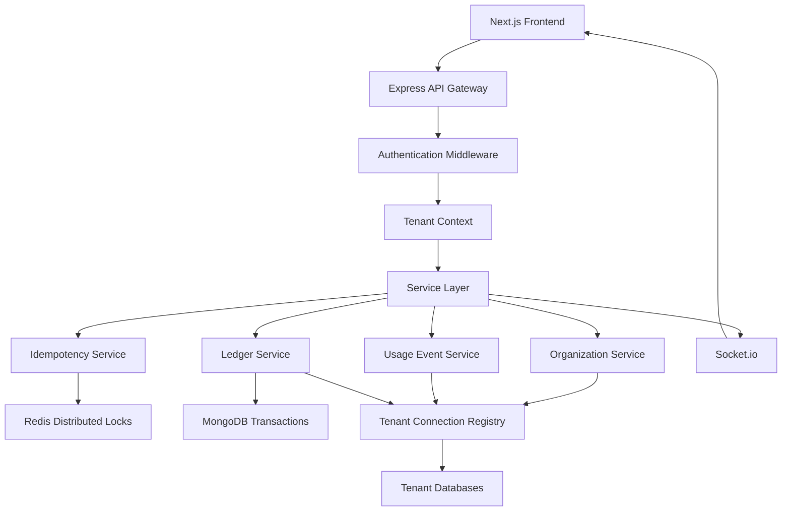

# LedgerGuard — System Architecture

## 1. Introduction

LedgerGuard is designed as a multi-tenant SaaS billing engine. Its architecture separates the frontend, API layer, authentication, tenant management, billing services, and data storage.

The primary architectural goals are:

- Secure tenant isolation.
- Reliable usage-event processing.
- Idempotent billing operations.
- Consistent financial ledger records.
- Scalable database connection management.
- Real-time analytics.

**Implementation status:** The frontend/backend foundation and MongoDB connection are implemented. The remaining architecture described below represents the planned system unless explicitly marked as implemented.

---

## 2. High-Level Architecture



This diagram describes the intended architecture, not the current implementation.

---

## 3. Frontend Layer

**Technology:** Next.js, React, TypeScript, Tailwind CSS.

Responsibilities:

- Display billing and usage analytics.
- Provide organization management.
- Display transaction and ledger history.
- Manage authenticated user sessions.
- Receive real-time updates.

Current implementation:

- Next.js application initialized.
- Basic LedgerGuard dashboard created.
- Backend health-check integration working.

---

## 4. Backend API Layer

**Technology:** Node.js, Express.js, TypeScript.

Responsibilities:

- Handle incoming HTTP requests.
- Validate incoming data.
- Authenticate users.
- Resolve tenant context.
- Execute business logic.
- Return standardized API responses.
- Handle application errors centrally.

Current implementation:

- Express server initialized.
- `/api/health` endpoint implemented.
- Environment validation implemented.
- Centralized error middleware implemented.
- Frontend-to-backend integration verified.

---

## 5. Authentication and Authorization

Planned authentication flow:

1. User registers or logs in.
2. Password is verified securely.
3. Backend issues an authentication token.
4. Protected API requests include the token.
5. Authentication middleware verifies the token.
6. Tenant context is derived from verified membership and authorization data.

JWT authentication and role-based authorization are planned.

A client-provided organization identifier must never be treated as proof of authorization.

---

## 6. Multi-Tenant Database Architecture

LedgerGuard plans to use a tenant connection registry to manage database connections dynamically.

Responsibilities:

- Resolve authorized tenant database connections.
- Reuse existing connections.
- Avoid unnecessary connection creation.
- Manage connection lifecycle.
- Handle database failures safely.
- Prevent cross-tenant data access.

The connection registry will be implemented as a backend service.

---

## 7. Usage Event Processing

The planned usage pipeline:

1. Receive a usage event.
2. Validate the event payload.
3. Resolve the authenticated tenant.
4. Check the event's unique identifier.
5. Apply idempotency protection.
6. Record the event.
7. Trigger the appropriate ledger operation.
8. Make updated usage information available to analytics.

Unique database indexes will provide durable duplicate protection.

---

## 8. Idempotency and Distributed Locking

**Planned technologies:** MongoDB and Redis.

Redis distributed locks will coordinate concurrent operations.

The database will enforce unique event identifiers to ensure durable idempotency.

Lock implementation requirements:

- Time-to-live expiration.
- Unique ownership tokens.
- Ownership-based safe release.
- Failure and timeout handling.
- Database-level duplicate protection.

Redis locks alone will not guarantee financial correctness.

---

## 9. Financial Ledger

The ledger will record financial changes through structured entries.

Planned responsibilities:

- Record debit and credit operations.
- Link ledger entries to usage events.
- Preserve transaction references.
- Calculate account balances.
- Prevent duplicate financial entries.
- Maintain an auditable transaction history.

MongoDB transactions will be used for operations requiring atomic multi-document updates.

MongoDB transaction support requires a replica set or sharded cluster.

---

## 10. Real-Time Communication

**Planned technology:** Socket.io.

Real-time functionality will support:

- Usage updates.
- Ledger activity notifications.
- Dashboard refresh events.
- Organization-specific notifications.

Socket connections and rooms must be authenticated and tenant-aware.

---

## 11. Cryptographic Layer

**Planned technology:** RSA signatures with SHA-256 (RSA-SHA256).

The cryptographic layer will provide:

- Key-pair generation.
- Payload signing.
- Signature verification.
- Tamper detection.
- Secure private-key handling.

Digital signatures provide authenticity and integrity verification. They do not automatically provide zero-knowledge privacy or tenant isolation.

---

## 12. Data Flow Summary

The intended usage-to-ledger flow:

```text
Usage Request
     |
     v
Request Validation
     |
     v
Authentication
     |
     v
Tenant Resolution
     |
     v
Idempotency Check
     |
     v
Usage Event Storage
     |
     v
Ledger Transaction
     |
     v
Balance / Usage Update
     |
     v
Analytics Dashboard
```

---

## 13. Architecture Development Status

| Component | Status |
|---|---|
| Next.js frontend | Implemented |
| Express backend | Implemented |
| MongoDB connection | Implemented |
| Environment validation | Implemented |
| Centralized error handling | Implemented |
| Authentication | Planned |
| Tenant context | Planned |
| Dynamic tenant connections | Planned |
| Redis locks | Planned |
| Usage processing | Planned |
| Financial ledger | Planned |
| MongoDB transactions | Planned |
| Socket.io | Planned |
| RSA-SHA256 | Planned |

---

## 14. Future Architectural Improvements

Potential improvements include:

- Background workers for usage processing.
- Improved observability and structured logging.
- Database indexing and query optimization.
- Automated integration and concurrency testing.
- Deployment and infrastructure monitoring.

---

**Last updated:** November 15, 2026
**Project:** LedgerGuard